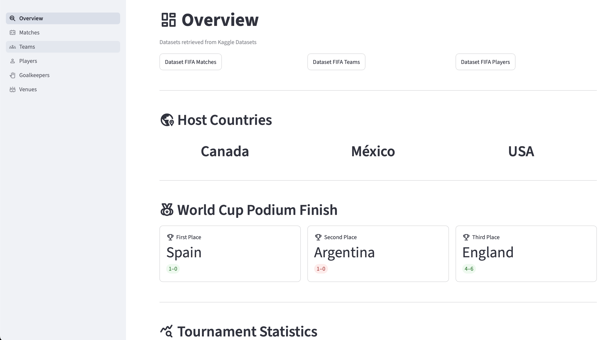
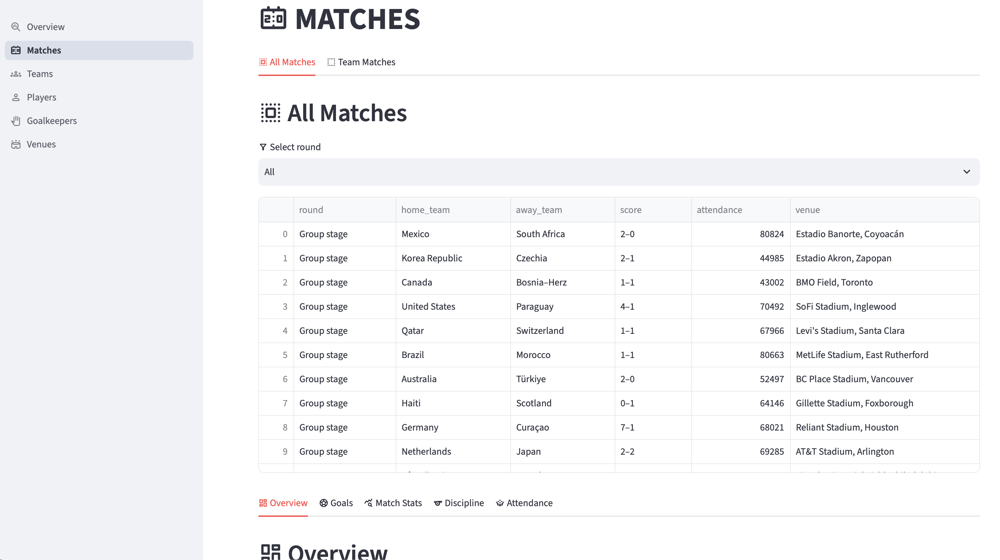
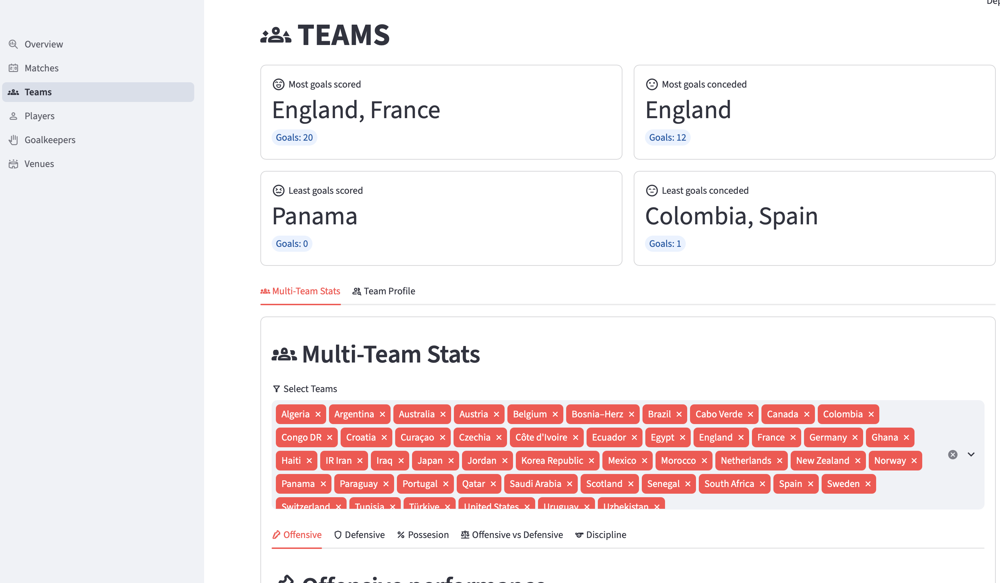
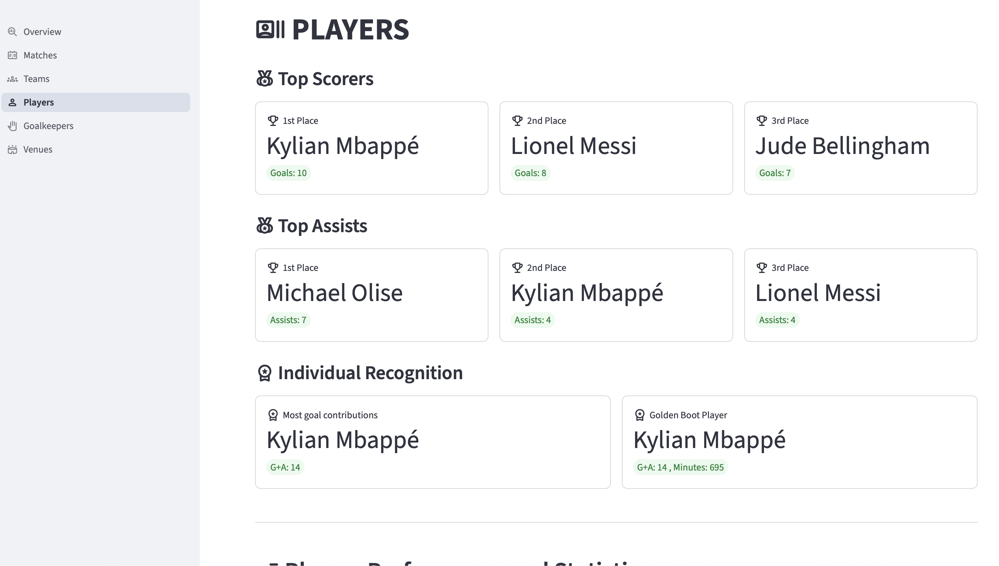
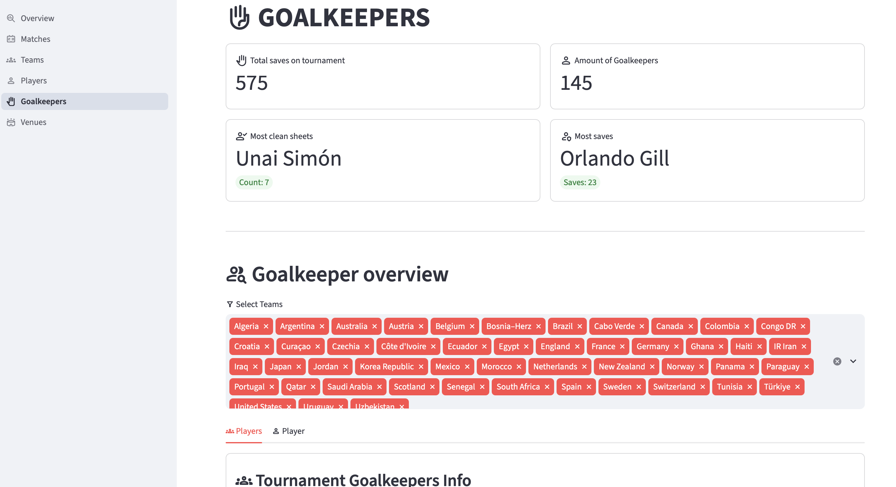
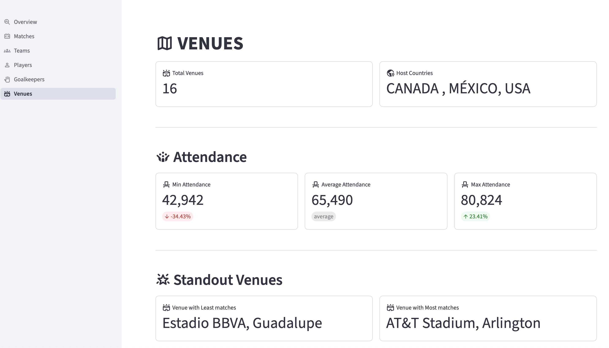

# dashboard_worldcup_2026

An interactive dashboard built with Streamlit to explore FIFA World Cup matches , teams, players, goalkeepers and venue information.

Live demo: https://dashboardworldcup2026.streamlit.app

## Pages

**Overview:** Tournament statistics, podium results, common formations, and team and player visualizations.

**Matches:** Match statistics, showing charts for comparison and seeing team difference in a particular match.

**Teams:** Explore team statistics and performance.

**Players:** Analyze player statistics, including goals, assists, age, and playing time.

**Goalkeepers:** Goalkeepers statistics all and individual statistics, metrics and charts.

**Venues:** Explore attendance records, standout venues, and venue locations on an interactive map.

## Screenshots














## Installation and Usage

Prerequisites

Python 3.10 or a compatible version

pip

- Clone the repo
```
git clone https://github.com/AlexaBF/dashboard_worldcup_2026.git

cd dashboard_worldcup_2026
```

- Install dependencies

```
pip install -r requirements.txt
```

- Run the application

```
streamlit run main.py
```

Make sure the CSV files are available in the datasets/ directory before launching the application.

## Technologies Used

Python

Streamlit

pandas

NumPy

Plotly Express

## Data Sources
The dashboard uses datasets obtained from Kaggle:

- Link to matches dataset: [FIFA World Cup 2026 Match Data](https://www.kaggle.com/datasets/swaptr/fifa-wc-2026-matches).

- Link to teams dataset: [FIFA World Cup 2026 Team Data](https://www.kaggle.com/datasets/swaptr/fifa-wc-2026-teams).

- Link to players dataset: [FIFA World Cup 2026 Player Data](https://www.kaggle.com/datasets/swaptr/fifa-wc-2026-players).

> Thanks to the dataset contributors on Kaggle for making the data available.

> Also to the Streamlit Community for the documentation provided.
